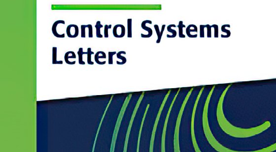

# Academic website template: guide for AI assistants

Read this file before changing anything in this repository. It describes how the website is built,
the conventions every page follows, and the procedures for filling it in and keeping it up to date.
The owner of the site will usually write to you in their own language; the pages are in English
unless the owner asks otherwise.

## 1. What this repository is

- A **static website** (plain HTML, one stylesheet `site.css`, one script `site.js`), published by
  **GitHub Pages** from the `main` branch of the repository `<user>.github.io`. There is no build step,
  no framework and no package manager: what is in the repository is what is online.
- GitHub Pages runs its default Jekyll only to copy the files; `_config.yml` excludes the helper files
  (scripts, JSON, Markdown) so that they are not published.
- Three Python scripts (standard library only) do the repetitive work:
  - `sync_site.py` regenerates the generated parts of the pages (see §3). **Run it after every change.**
  - `add_paper.py` adds a publication interactively (BibTeX and abstract downloaded automatically).
  - `generate_paper_previews.py` renders the first-page thumbnails of the homepage papers (needs PyMuPDF).
  - `setup_site.py` is run once, when the template is copied (owner name, address, e-mail, statistics).
- The site sets **no cookies** and loads nothing from third parties, except the optional GoatCounter
  statistics (cookieless) and the publishers' sites the visitor clicks on. Fonts are served from `fonts/`.

## 2. Ground rules

1. **Never invent content.** Publications, dates, awards, projects, roles, co-authors and links must come
   from the owner or from sources the owner points to (CV, DOI, arXiv, institutional pages). If something
   is uncertain, ask. Before adding or changing publications, show the owner the list and wait for
   confirmation.
2. **Edit the sources, not the generated parts.** Never edit by hand: the news list and the "Selected
   publications" cards of `index.html`, `sitemap.xml`, the "Last update" footer date, and the `?v=…`
   versions of `site.css`/`site.js` in the pages. They are rewritten by `sync_site.py`.
3. **After every change run `python sync_site.py`**, then check the result in a browser (§11).
4. **Keep the markup conventions** of this file: the filters, the popups and the scripts rely on them.
5. **Keep addresses stable.** Do not rename or delete files in `files/` that may be linked from outside
   (papers, CV): replace their content instead, or add a redirect in `404.html` (§9).
6. Keep the design: colours, fonts and layout come from `site.css`; do not add frameworks, CDNs,
   trackers or cookie banners.

## 3. Files

| Path | Role |
|---|---|
| `index.html` | Home: photo and contacts, News (generated), Selected publications (generated), research interests |
| `Biography.html` | Biography in sections (position, education, awards, projects, talks, supervision, service, interests) |
| `Publications.html` | **Source of truth** for all publications (titles, authors, links, materials, BibTeX, abstracts) |
| `Teachings.html` | Courses and teaching material |
| `News.html` | **Source of truth** for the news: complete archive, newest first |
| `404.html` | Page shown for any missing address; uses absolute paths (`/site.css`); can forward old addresses |
| `site.css`, `site.js` | The only stylesheet and script (see §10) |
| `site.json` | Configuration (see §4) |
| `coauthors.json` | Co-author name (as written on the page) → personal/academic page, or `null` |
| `files/` | PDFs and other material: CV, manuscripts, slides, posters, course material |
| `files/published/` | Optional publisher PDFs used only for thumbnails; ignored by git, never published |
| `images/` | `photo.jpg` (owner's portrait, 4:5), venue logos (570×316 JPEG), `selected/` thumbnails |
| `fonts/` | Open Sans, Oswald, Roboto (WOFF2, OFL licences) |
| `sitemap.xml`, `robots.txt` | For search engines; the sitemap is generated |
| `.github/workflows/check-links.yml` | Weekly check of all links; broken links are reported in a GitHub issue |
| `README.md` | Quick start for the owner (in Italian) |

## 4. `site.json`

```json
{
  "name": "Mario Rossi",
  "short_name": "M. Rossi",
  "site_url": "https://mariorossi.github.io/",
  "selected": ["J03", "J02", "J01", "C01", "A01"],
  "news_on_home": 6,
  "venue_labels": {"TAC": "IEEE TAC", "L-CSS": "IEEE L-CSS", "TASE": "IEEE T-ASE"}
}
```

- `short_name` is how the owner appears in author lists; `add_paper.py` underlines it (`<span class="me">`).
- `selected`: labels of the papers shown on the homepage. The layout is designed for **five** cards.
  Each needs a thumbnail `images/selected/<label in lower case>.png` (run `generate_paper_previews.py`).
- `venue_labels`: optional nicer names for the cards (data-venue → label); other venues show the tag itself.

## 5. Publications (`Publications.html`)

### Structure

After the PhD section and the empty filter section (filled by `site.js`), three categories, each a red banner
followed by its papers, **newest first**:

| Category | Banner id | Labels |
|---|---|---|
| arXiv preprints / under review | `section-category-arxiv` | `A01`, `A02`, … |
| Journal articles | `section-category-j` | `J01`, `J02`, … |
| Conference proceedings | `section-category-c` | `C01`, `C02`, … |

Labels are two-digit, increase with time and are never reused; the newest paper has the highest number.
Consecutive papers of a category are separated by `<hr class="pub-sep container">` (none after the last one).

### One entry

```html
    <article class="pub container" id="section-J02" data-year="2026" data-venue="L-CSS">
      <div class="pub-label">[J02]</div>
      <div class="pub-body">
        <h3 class="pub-title"><a href="https://doi.org/10.1109/LCSYS.2026.0000000" target="_blank">Title in Normal Case</a></h3>
        <p class="pub-info">A. Bianchi, <span class="me">M. Rossi</span>, <a class="coauthor" href="https://example.org/verdi" target="_blank">C. Verdi</a><br>IEEE Control Systems Letters, 2026 &ndash; presented at CDC 2026, see&nbsp;<a class="xref" href="#section-C02">[C02]</a><br><span class="mat"><button type="button" class="bib-btn">BibTeX</button><button type="button" class="abs-btn">Abstract</button><a href="files/LCSS26%20-%20SHORT%20-%20Manuscript.pdf" target="_blank">Manuscript</a><a href="files/LCSS26%20-%20SHORT%20-%20Slides.pdf" target="_blank">Slides</a></span></p>
        <template class="bib">@article{bianchi2026short,
  author  = {Bianchi, Anna and Rossi, Mario and Verdi, Carlo},
  title   = {Title in Normal Case},
  journal = {IEEE Control Systems Letters},
  volume  = {10},
  pages   = {1--6},
  year    = {2026},
  doi     = {10.1109/LCSYS.2026.0000000}
}</template>
        <template class="abstract">Plain-text abstract, no HTML, no LaTeX.</template>
      </div>
      <div class="pub-logo"><a href="https://ieeecss.org/publication/ieee-control-systems-letters" target="_blank"></a></div>
    </article>
```

Rules:
- **Title** typed in normal case (CSS shows it in capitals); linked to the DOI (`https://doi.org/…`) or the
  arXiv page. Accepted papers without a DOI yet: title without link, venue ending with "(accepted)".
- **Authors**: first line of `.pub-info`, names separated by ", ", written **always the same way** (e.g.
  "K.H. Johansson"): the Co-author filter is built from these strings. The owner is `<span class="me">`;
  co-authors with a page in `coauthors.json` are `<a class="coauthor">`.
- **Venue line**: only the venue and the year ("IEEE Transactions on Automatic Control, 2026"); volume and
  pages live in the BibTeX. Preprints: "Under review at <Journal> (2nd round), 2026".
- `data-year` (filters and counts) and `data-venue` (short tag shown in the "Published in" filter, e.g. TAC,
  L-CSS, CDC, Automatica; omitted for preprints) are required.
- **Same paper in two lists** (e.g. an L-CSS letter presented at CDC): one journal entry and one conference
  entry, linked to each other with `<a class="xref">`. A conference entry containing an xref to a `J` entry is
  shown but **not counted** in the totals, so the paper is counted once.
- **Material buttons**, in this order: BibTeX, Abstract, Manuscript, Slides, Poster, Video. Files go in
  `files/` named `<VENUE><YY> - <SHORT> - Manuscript.pdf` (also `- Slides.pdf`, `- Poster.pdf`), with spaces
  encoded as `%20` in the links. Video links: `https://youtu.be/<id>` (shown in a popup on every device) or any
  other URL (opened normally).
- **BibTeX**: from Crossref (DOI) or arXiv, inside `<template class="bib">`, HTML-escaped (`&amp;`).
  The same paper listed twice reuses the same entry and key.
- **Abstract**: plain text inside `<template class="abstract">`, HTML-escaped. Proofread it: abstracts from
  OpenAlex sometimes glue words around italics ("inopen networks") and LaTeX must be turned into text.
- **Logo**: `images/<NAME>.jpg`, 570×316 px, linked to the journal or conference homepage. Official logos
  are preferred; `images/venue.jpg` is a generic fallback. Several common control venues are included.

### Adding a paper

- Interactive: `python add_paper.py` asks type, title, authors, venue, year, link, logo and file names,
  downloads BibTeX and abstract, inserts the entry at the top of its category with the next label, asks once
  for the web page of new co-authors, then runs `sync_site.py`.
- By hand (or as an AI): write the entry exactly as above, at the top of its category, with the next label,
  then run `python sync_site.py`. To get BibTeX and abstract you can call the functions of `add_paper.py`
  (`fetch_bibtex`, `fetch_abstract`, `render_paper`) from Python.
- Preprint accepted: move it from the arXiv category to the journal/conference one (new label, DOI link,
  publisher BibTeX), and update `selected` in `site.json` if it was on the homepage.
- Co-author pages: edit `coauthors.json`, then `python add_paper.py --relink` relinks every author line.

## 6. Homepage (`index.html`)

- **Hero**: `images/photo.jpg` (portrait 4:5, about 600×750 px; the frame keeps it as tall as the text next
  to it), name, role, department link, address, and the profile buttons (CV, e-mail, Google Scholar, ORCID,
  Scopus, ResearchGate, institutional page). Remove the buttons the owner does not have.
- **News**: generated from `News.html` (the `news_on_home` most recent items).
- **Selected publications**: generated from `Publications.html` for the labels in `site.json`. Thumbnails
  from the owner's manuscripts are fine; thumbnails of publisher PDFs only if their licence allows it
  (e.g. CC BY), with the commented `thumbnail-credits` block filled in and uncommented.
- **Research interests / Application areas**: short lines `-&nbsp;Topic&nbsp;-` separated by `<br>`.
- Keep in `<head>`: canonical URL, description, Open Graph tags and the JSON-LD `Person` (update `sameAs` with
  the owner's real profile URLs: ORCID, Scholar, Scopus, institutional page).

## 7. Other pages

- **Biography**: one `<section class="bio-section">` per topic with an `h2` and a `.bio-content`.
  Dated lists use `<dl class="bio-dates">` (education) or `<dl class="bio-dates bio-list">` (wider date
  column, e.g. "2025–2028", "Since 2024"); sub-groups use `h3`. Section ids (`bio-projects`, …) can be linked.
- **Teaching**: per course, a `<section class="banner">` with the course name and a `<section class="course-body">`
  with a `.course-description` and lines `<span class="label">Name:</span><a>…</a><span class="sep">-</span><a>…</a>`.
  Add `lang="it"` (or other) to both sections for courses taught in another language.
- **News** (`News.html`): items `<li><time datetime="YYYY-MM">Mon YYYY</time><p>…</p></li>` in
  `<ul class="news-list is-archive">`, newest first; link papers as `Publications.html#section-J03`.
  Write news in the past tense, or "Upcoming at …" for future events; dates must be verified.

## 8. Adding a page

Copy the structure of `Teachings.html` (head, header, footer), add the new link to the `<nav>` of **every**
page (including `404.html`, where links are absolute: `/NewPage.html`), mark it with `aria-current="page"` on
the page itself, add its name to `PAGES` in `sync_site.py` (so it gets versions, footer date and sitemap) and
to `setup_site.py`'s `PAGES` if the template placeholders appear in it.

## 9. Addresses, redirects, statistics, search engines

- `404.html` contains a small table `moved` to forward old addresses (e.g. pages of a previous website).
- GoatCounter (optional, free, no cookies): `setup_site.py` inserts the code; opening a PDF, a video or an
  abstract is counted as an event (`site.js`).
- Google Search Console: verify the site (HTML file method: add the file Google provides to the root) and
  submit `sitemap.xml` once; it is regenerated by `sync_site.py`.

## 10. Design and behaviour

- `site.css`: colours as CSS variables in `:root` (`--accent` red, `--accent-hover`, `--dark`, `--text`,
  `--light-bg`); breakpoints xl ≥ 1200, lg 992–1199, md 768–991 (menu becomes a side panel), sm 576–767
  (one column), xs ≤ 575. Headings use Oswald, text Open Sans.
- `site.js`: mobile menu; BibTeX and Abstract popups; material popup (on desktop, local PDFs open over the
  page; YouTube and ETH video links open in a popup on every device; Ctrl/middle click still opens a new tab);
  publication filters (type, year, venue, co-author, free-text search) and de-duplicated counts;
  GoatCounter events.

## 11. Checking and publishing

1. `python sync_site.py` (it prints a warning for linked files that do not exist yet).
2. Preview: `python -m http.server 8000` in the repository folder, then open http://localhost:8000.
   Check desktop and phone width (≈ 390 px): no horizontal scrolling, no console errors, popups and filters work.
3. Commit with a clear message and push to `main`; the site is online after about one minute
   (browsers may cache for 10 minutes: reload with Ctrl+F5).
4. The weekly link check opens an issue labelled `broken links` if something breaks; fix and close it.

## 12. Producing PDFs from LaTeX

- Compile IEEE templates with **pdfLaTeX**, not XeLaTeX (XeLaTeX silently replaces Times with Latin Modern).
- Remove reviewer highlights (coloured text, margin notes) before publishing a manuscript: redefine the
  highlighting macros as empty in a copy of the source, never in the shared original.
- Prefer the accepted version of the manuscript (the one matching the published paper).
